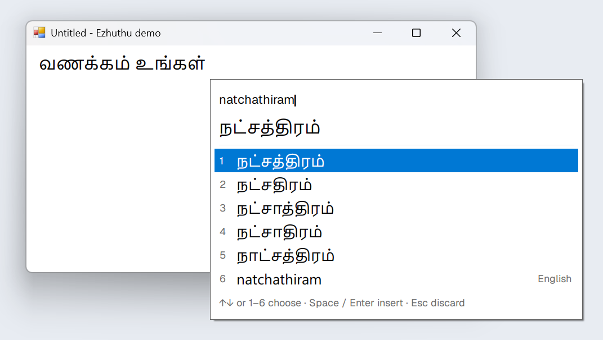
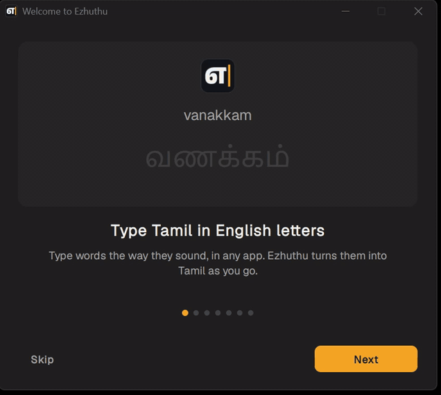
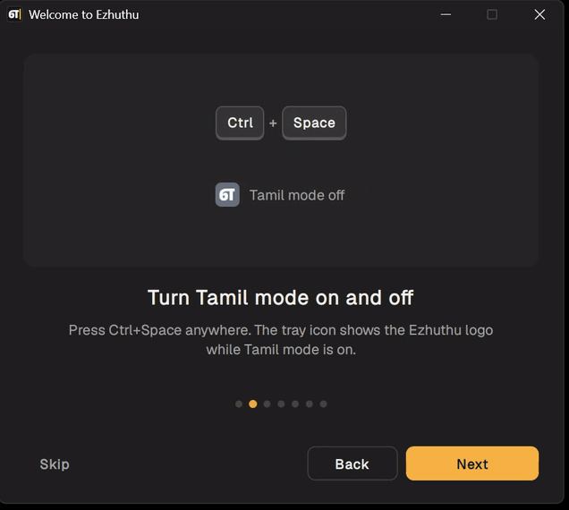
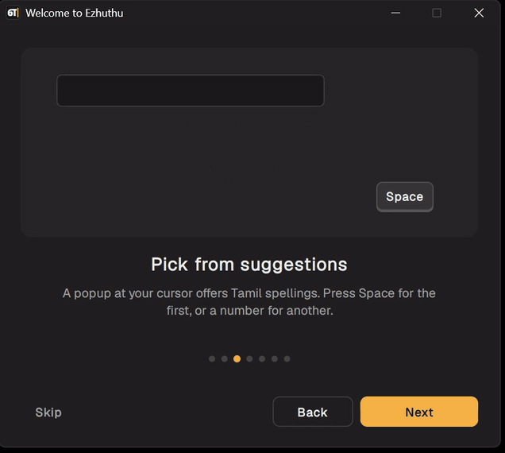
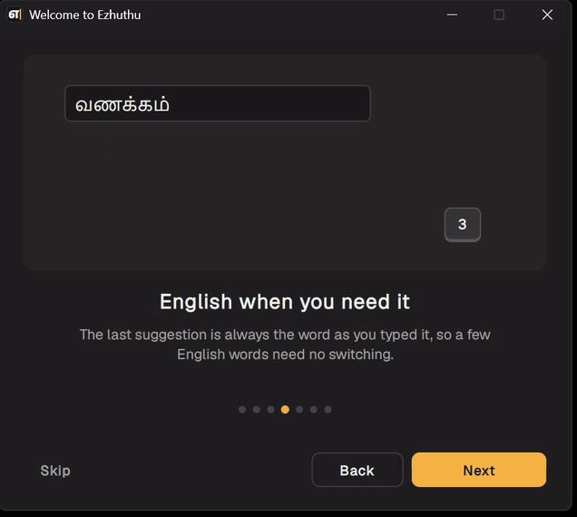
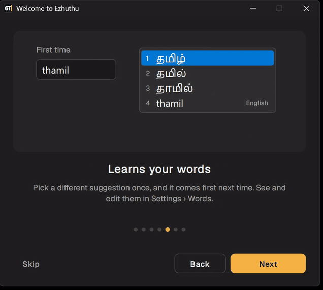
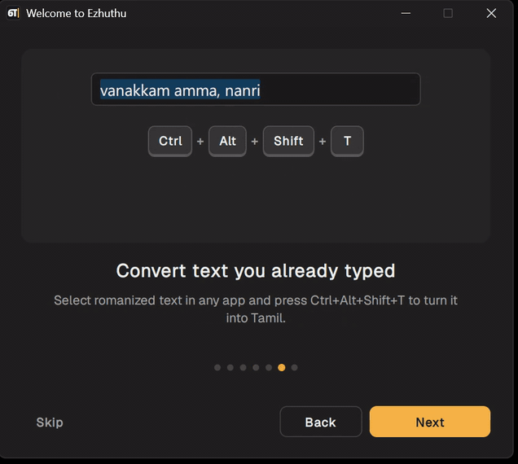
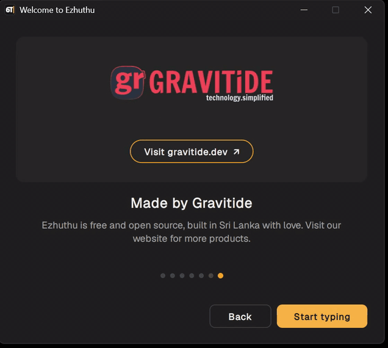

<p align="center">
  
</p>

<h1 align="center">Ezhuthu (எழுத்து)</h1>

<p align="center">
  <strong>Type Tamil in English letters, in any Windows app.</strong><br>
  Type <code>natchathiram</code>, get நட்சத்திரம்.
</p>

<p align="center">
  <a href="https://github.com/srisar/ezhuthu/releases/latest"></a>
  <a href="LICENSE"></a>
</p>

Ezhuthu is a free, open-source Tamil phonetic keyboard for Windows. Press a shortcut to turn on Tamil mode, type words the way they sound, and pick from the suggestions that appear at your cursor. It's a small native tray app. The [AI4Bharat IndicXlit](https://github.com/AI4Bharat/IndicXlit) transliteration model runs on your PC, so it works offline and nothing you type leaves your computer.

<p align="center">
  
</p>

## See it in action

<table>
  <tr>
    <td width="50%"></td>
    <td width="50%"></td>
  </tr>
  <tr>
    <td width="50%"></td>
    <td width="50%"></td>
  </tr>
  <tr>
    <td width="50%"></td>
    <td width="50%"></td>
  </tr>
</table>

## Features

- **Works everywhere:** Notepad, Word, browsers, VS Code, chat apps and the Start menu search box.
- **Suggestions at the cursor:** up to 9 Tamil candidates per word, ranked by how common each word is. Pick one with a number or the arrow keys.
- **English when you need it:** the last suggestion is always the word exactly as you typed it, so a few English words don't need a mode switch.
- **Learns your words:** pick a different suggestion once and it comes first next time.
- **Convert selected text:** select romanized text you've already typed, press Ctrl+Alt+Shift+T, and it becomes Tamil.
- **One shortcut:** Ctrl+Alt+T by default. Choose a preset or any combination in Settings.
- **Private and offline:** no internet, no account. Password fields are never touched.
- **Light and dark:** the popup follows Windows' light or dark mode, or pick one in Settings.
- **Lightweight:** installs per user with no administrator rights, and starts with Windows if you like.

## Install

Requires Windows 10 or 11 (64-bit).

1. Download `ezhuthu-setup-<version>.exe` from the [latest release](https://github.com/srisar/ezhuthu/releases/latest).
2. Run it. The setup isn't code-signed yet, so Windows SmartScreen may warn the first time. Choose **More info > Run anyway**.
3. Keep the default folder (`%LOCALAPPDATA%\Programs\ezhuthu`) or **Browse…** to another, choose whether to start with Windows, and click **Install**.

Setup adds a Start Menu shortcut and an entry in **Settings > Apps**, then starts Ezhuthu in the tray. Running a newer setup updates in place and keeps your settings. To uninstall, use **Settings > Apps > Ezhuthu > Uninstall**.

<details>
<summary>Install details</summary>

- Setup restricts the install folder so only you, SYSTEM and Administrators can change it. A drive without permissions (FAT32/exFAT) is refused.
- Uninstall runs `ezhuthu.exe --uninstall` and deletes only Ezhuthu's own files (a fixed list built into the program, after checking for links), so anything else in the folder is left alone. Settings in `%APPDATA%\ezhuthu` are kept.
- Unattended install: `ezhuthu-setup.exe --silent [--dir <folder>] [--autostart] [--no-launch]`.

</details>

## Using Ezhuthu

The first time Ezhuthu starts, a short welcome tour shows each feature with an animated example. Open it again any time from the tray menu: **Welcome tour**.

Ezhuthu lives in the tray. **Ctrl+Alt+T** turns Tamil mode on or off. The tray icon shows the Ezhuthu logo when it's on and turns grey when it's off. While it's on, type Tamil in English letters, a word at a time. A popup at the cursor shows the suggestions:

| Key (while a word is in progress) | Action |
|---|---|
| Space | insert the chosen Tamil word and a space |
| Enter | insert the chosen word without a space |
| 1–9 (0 for a tenth row) | insert that suggestion and a space |
| ↑ / ↓ | choose a suggestion |
| Backspace / Ctrl+Backspace | delete a letter / drop the word |
| Esc | drop the word |
| any other key (Tab, arrows, Ctrl+S…) | insert the word, then the key does its usual job |

The last row is always the word exactly as you typed it, marked **English**: press its number, or ↓ to it and Space.

Ezhuthu remembers your choices. When you insert a suggestion other than the first, it comes first the next time you type that word. Pick the original first suggestion again to undo this. Only the words you picked are kept, in `%APPDATA%\ezhuthu\learned.tsv` on your PC. See, change, add or remove them on the **Words** tab in Settings, or turn learning off on General.

When no word is in progress, digits, punctuation, Enter, arrows and shortcuts type normally. Punctuation typed right after a word stays with it, so `amma,` gives அம்மா,. The popup never takes focus, so it also works over the Start menu search box.

### Convert selection

Already typed something in English letters, or pasted it from elsewhere? Select it in any app and press **Ctrl+Alt+Shift+T**. This works whether Tamil mode is on or off. A small badge by the cursor shows a spinner while it converts, then a check mark. Every word becomes its top Tamil suggestion, using the words Ezhuthu has learned from you. Spaces, line breaks, numbers, punctuation and text already in Tamil stay as they are. Ezhuthu copies the selection, pastes the Tamil over it, and puts your clipboard back the way it was. If another window comes to the front before it finishes, it cancels. It converts up to 300 different words at a time.

### Settings

Right-click the tray icon and choose **Settings...** (launching Ezhuthu again while it's running also opens it).

- **General** sets:
  - suggestions per word;
  - how text is inserted (typing, or pasting for apps that garble typed Tamil);
  - remembering the suggestions you pick;
  - the popup theme: match Windows (default), light or dark;
  - Start with Windows.
- **Shortcuts** sets:
  - the Tamil mode shortcut (one of four presets, or any custom combination);
  - the convert selection shortcut (or turns it off).
- **Words** lists the words Ezhuthu has learned, with a search box. Select one to change its Tamil spelling, choosing from the model's suggestions or pasting your own. Type a new word to add it, or remove words. Changes apply when you press OK.
- **About** shows the version, the source code link and the credits.

Settings are saved in `%APPDATA%\ezhuthu\config.toml`.

## Development

Ezhuthu is written in Rust with plain Win32 (the `windows` crate). There are no web or GUI frameworks. The workspace:

| Crate | What it is |
|---|---|
| `crates/xlit` | `ezhuthu-xlit`: model loading, beam search and word-frequency rescoring on [tract](https://github.com/sonos/tract), plus `xlit-cli` |
| `crates/app` | `ezhuthu.exe`: the tray app, keyboard hook, popup and Settings window |
| `crates/install` | install, uninstall and autostart logic shared by the app and setup |
| `crates/setup` | `ezhuthu-setup.exe`: the installer, with the app and model embedded |
| `tools/` | asset fetch, installer and release scripts; Python model export and icon tools |

The design notes and the original plan are in [HANDOFF.md](HANDOFF.md).

### Build and run

```bash
tools/fetch-assets.sh            # model files into assets/ (needs the GitHub CLI, signed in)
cargo build --release -p ezhuthu
./target/release/ezhuthu.exe
```

The release profile uses LTO with `codegen-units = 1`, so the first release build takes several minutes. For quicker iterations, use `cargo build --profile fast -p ezhuthu` (optimized, no LTO, with a console window for logs). The app looks for model files in `assets/` next to the exe. Dev builds (`dev` and `fast` profiles) also look in the workspace `assets/`.

### Installer and releases

```bash
tools/build-installer.sh   # -> dist/ezhuthu-setup-<version>.exe
```

The installer is a single self-contained file: the release `ezhuthu.exe` plus the model assets.

To publish a release:
1. Bump `version` in `Cargo.toml` and merge to main.
2. Run `tools/release.sh` from an up-to-date main. It tags `v<version>` and pushes the tag; `--dry-run` runs only the local checks.
3. GitHub Actions ([`release.yml`](.github/workflows/release.yml)) checks formatting, lints and tests on Windows, builds the installer and creates the GitHub release with the installer and its SHA-256.

To rebuild an existing tag, use **Actions > Release > Run workflow**. It keeps the installer as a workflow artifact, or replaces the release files if **publish** is ticked.

### Transliteration library and CLI (Rust)

`crates/xlit` (`ezhuthu-xlit`) is pure Rust: ONNX runs on [tract](https://github.com/sonos/tract), with no DLLs. It needs the exported assets in `assets/` (see below).

```bash
cargo run --release --bin xlit-cli -- natchathiram vanakkam
cargo run --release --bin xlit-cli -- --bench tests/words.tsv
cargo test --release -p ezhuthu-xlit
```

The tests check the §8 acceptance words (each expected word in the top 5) and exact top-5 parity with the Python reference on `tests/golden_top5.tsv`. To regenerate that file after re-exporting, run `uv run python xlit_ref.py --golden ../../tests/parity_words.txt > ../../tests/golden_top5.tsv` from `tools/export`.

### Model export (one-time, Python)

Python is used only to produce the ONNX assets and is never shipped. You need [uv](https://docs.astral.sh/uv/). Python 3.10 is pinned in `tools/export/.python-version`.

```bash
cd tools/export

# 1. Get the checkpoint (127 MB) into the gitignored work/ directory
mkdir -p work/download
curl -L -o work/download/indicxlit-en-indic-v1.0.zip \
  https://github.com/AI4Bharat/IndicXlit/releases/download/v1.0/indicxlit-en-indic-v1.0.zip
unzip -o work/download/indicxlit-en-indic-v1.0.zip -d work/model

# 2. Reference transliteration (PyTorch)
uv run python xlit_ref.py natchathiram vanakkam

# 3. Export to ../../assets/ and check ONNX against PyTorch
uv run python export_onnx.py
uv run python parity.py
```

#### Verifying against fairseq (optional)

`fairseq_check.py` runs the checkpoint through real fairseq 0.12.2 so you can diff its output against `xlit_ref.py`. fairseq's C++ extensions don't build here, but generation doesn't need them, so it runs from the unpacked sdist in a throwaway venv:

```bash
cd tools/export/work
uv venv --python 3.10 fairseq-venv
VIRTUAL_ENV="$PWD/fairseq-venv" uv pip install --extra-index-url https://download.pytorch.org/whl/cpu \
  --index-strategy unsafe-best-match "torch==2.4.1+cpu" "numpy<2" "hydra-core==1.0.7" "omegaconf==2.0.6" \
  bitarray sacrebleu regex tqdm cffi
curl -L https://files.pythonhosted.org/packages/source/f/fairseq/fairseq-0.12.2.tar.gz | tar xz
printf '%s\n' en as bn brx gom gu hi kn ks mai ml mni mr ne or pa sa sd si ta te ur > model/lang_list.txt
cd ..
PYTHONPATH="$PWD/work/fairseq-0.12.2" work/fairseq-venv/Scripts/python.exe \
  fairseq_check.py work/model 5 $(cut -f1 ../../tests/words.tsv) > work/fairseq_out.txt
uv run python xlit_ref.py $(cut -f1 ../../tests/words.tsv) > work/ref_out.txt
diff work/fairseq_out.txt work/ref_out.txt && echo identical
```

### Assets

Model files are never committed. `assets/` is gitignored. To get the files, run:

```bash
tools/fetch-assets.sh
```

This downloads the `assets-v1` GitHub Release (about 58 MB) with `gh` and verifies it against `tools/assets.sha256`. You need the GitHub CLI, signed in (`gh auth login`). [assets/README.md](assets/README.md) lists the files.

To rebuild the word-frequency dictionary from upstream, run these from `tools/export`. `fetch` downloads only the 105 MB Tamil entry of the 850 MB zip.

```bash
uv run python word_freq.py fetch
uv run python word_freq.py build --top 500000
```

If you rebuild any asset, update `tools/assets.sha256` and publish a new release tag.

### Icons

The app and tray icons are committed in `crates/app/icons/`, and the build scripts link them into `ezhuthu.exe` and `ezhuthu-setup.exe` without a resource compiler. The mark is எ followed by a text cursor on a dark tile; the "off" tray icon is the letter on grey. `ezhuthu.svg` is the vector master. To redraw them, run this from `tools/icons` (the font is only needed here, never shipped):

```bash
curl -L -o "work/AnekTamil[wdth,wght].ttf" "https://github.com/google/fonts/raw/main/ofl/anektamil/AnekTamil%5Bwdth,wght%5D.ttf"
uv run make_icons.py "work/AnekTamil[wdth,wght].ttf" ../../crates/app/icons --preview work/preview.png
```

The letter's outline comes from Anek Tamil ExtraBold (SIL Open Font License 1.1).

The welcome tour's last card shows the Gravitide logo, rendered from `crates/app/logo/gravitide-logo-full.svg` into two images (for light and dark themes) that the app embeds. To redraw them, run this from `tools/icons`:

```bash
uv run --with resvg-py make_logo.py ../../crates/app/logo/gravitide-logo-full.svg
```

## Credits

- **Transliteration model:** [IndicXlit](https://github.com/AI4Bharat/IndicXlit) by AI4Bharat, checkpoint `indicxlit-en-indic-v1.0`. MIT license, covering both code and models. Madhani et al., *Aksharantar: Open Indic-language Transliteration datasets and models for the Next Billion Users* (2022).
- **Word frequencies:** IndicXlit word-probability data by AI4Bharat (MIT).
- **Model runtime:** [tract](https://github.com/sonos/tract) by Sonos (MIT / Apache-2.0).
- **Logo letter:** [Anek Tamil](https://fonts.google.com/specimen/Anek+Tamil) by Ek Type (SIL Open Font License 1.1).

## License

Ezhuthu is free and open source under the [MIT License](LICENSE). The model, word data, tract and Anek Tamil keep their own licenses, listed above. The Gravitide name and logo belong to Gravitide and are not covered by the MIT License.

<p align="center">
  <a href="https://gravitide.dev"></a>
</p>

<p align="center">Built by <a href="https://gravitide.dev">Gravitide</a> from Sri Lanka with Love ❤️</p>
